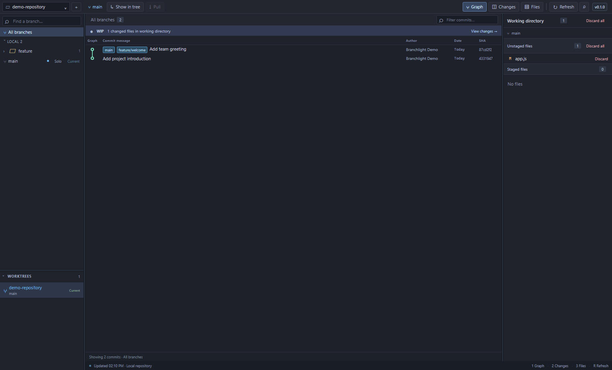

# Branchlight

A local Git desktop app for browsing commit history, reviewing changes, switching branches, and managing linked worktrees. This repository contains the complete standalone Git project and its tests. It is separate from DevDeck.



## Download and run on Windows

1. Install [Git for Windows](https://git-scm.com/download/win) and make Git available on PATH.
2. Download **Branchlight.exe** from the [latest release](https://github.com/sdesrosierstheroux/branchlight/releases/latest). Repository access is required while this project is private.
3. Keep the executable in a permanent folder and double-click it. Node.js is bundled; no separate Node installation is required.
4. Click the repository selector or press **Ctrl+O**, then choose **Open another folder… → Browse…** to open a checkout.

The Windows x64 download is portable and unsigned. Windows may show a publisher warning. The release includes SHA256SUMS.txt so you can compare the executable's checksum with PowerShell's Get-FileHash command.

Your repositories stay on your computer. No app account, hosted server, or GitHub token is required. Pull uses your existing Git authentication.

## What it does

- Commit graph with local and remote branch folders, tags, search, and branch soloing.
- Working directory view with staged and unstaged files, unified and side-by-side diffs, and text previews.
- Local and tracking branch checkout, plus **fast-forward-only Pull** from the current branch's upstream.
- Linked worktree browsing, with branch selection and navigation preserved between views.
- Confirmed file discard and worktree/local branch deletion, with checks for changed files, active Git operations, locks, and commits that have not been merged.
- Resizable panels, keyboard shortcuts, and a visible running version from package metadata.

Discard and deletion can permanently remove files. Review the confirmation carefully. Ignored files and unmerged commits need extra confirmation before worktree deletion; remote branches are never deleted.

This is not a complete Git client. There are no stage, commit, push, standalone fetch, stash, rebase, or conflict-resolution actions. Use Git or another client for those operations. History loads 200 commits initially, up to 1,000; merge diffs use the first parent. Binary previews and recursive submodule browsing are not supported.

## Repository discovery and preferences

By default Branchlight discovers repositories directly inside **~/git** (on Windows, your user profile's git folder). It does not scan recursively. You can open a repository anywhere with Ctrl+O. Set **BRANCHLIGHT_REPOSITORIES** before launching to use another discovery folder.

Startup opens a repository passed on the command line, the last saved checkout, or the first discovered repository, in that order. With none available, use the repository selector to open a folder.

Windows preferences live in **%APPDATA%/branchlight-git**. This profile and the Windows application identity are separate from DevDeck. Copying the executable does not copy your repositories or preferences. Closing Branchlight stops its local service; a second launch focuses the existing window.

## Run from source

Requires Git and **Node.js 24 or newer**. The desktop app is currently distributed for Windows x64; the browser version can run on Windows, macOS, or Linux.

```powershell
npm ci
npm run desktop
```

Run the optional browser interface with:

```powershell
npm start
# Or choose a checkout and port explicitly:
node server.mjs "C:/work/my-project" --open --port=48765
```

In browser mode, keep the terminal open and use the printed launch link. The temporary token is removed from the address bar and kept in tab session storage. A fresh tab needs the launch link again.

On a corporate network that uses a certificate authority in the Windows trust store, set **NODE_USE_SYSTEM_CA=1** before installing or building. Keep certificate validation enabled.

## Build and verify the Windows app

```powershell
npm ci
npm test
npm run test:desktop
npm run release:check
npm run build:win
npm run test:package
```

Outputs are **dist/Branchlight.exe**, **dist/win-unpacked/Branchlight.exe**, and **dist/SHA256SUMS.txt**. The unpacked executable needs its entire win-unpacked folder; the portable executable can be shared on its own. Electron/Chromium notices remain in the distribution. The package check verifies the bundled version and source assets and rejects unrelated services and environment files.

Dependencies are pinned in package-lock.json. The Git runtime uses Node's built-in modules; Electron and electron-builder are development/build dependencies.

## Tests and releases

Automated tests create disposable repositories and exercise actual Git operations, worktree and discard safeguards, HTTP access controls, repository discovery, graph layout, and UI behavior. They do not modify repositories opened in your normal session. GitHub Actions runs the core tests on Windows and Linux. The desktop tests cover renderer navigation and the actual standalone launcher.

To publish an update, bump package.json and both root version entries in package-lock.json, update RELEASE_NOTES.md, and push a matching **vX.Y.Z** tag. The Windows release workflow runs the checks, builds and verifies the app, and creates a GitHub release containing the portable executable and checksum. Source archives are provided by GitHub.

The first v0.1.0 release is published from the verified local build. Later tagged releases use the workflow.

## Local access and security

The server listens only on 127.0.0.1. APIs require a random session token and validate Host and Origin; cross-site requests and embedded frames are blocked. Git commands use argument arrays and disable external diff/textconv and file-system monitor helpers. The renderer has sandboxing and context isolation, with no Node.js access. The desktop bridge permits only repository selection, preference access, and commit-hash copying from the main app frame. No telemetry, external scripts, or bundled credentials are included.

Review repository permissions before inviting teammates. Source is shared privately for team collaboration; no open-source license is granted by this repository.
